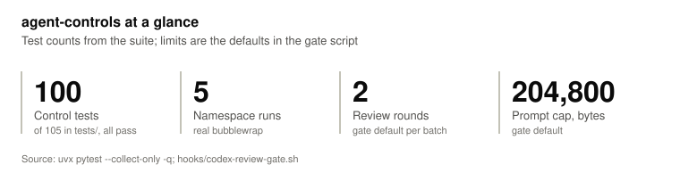
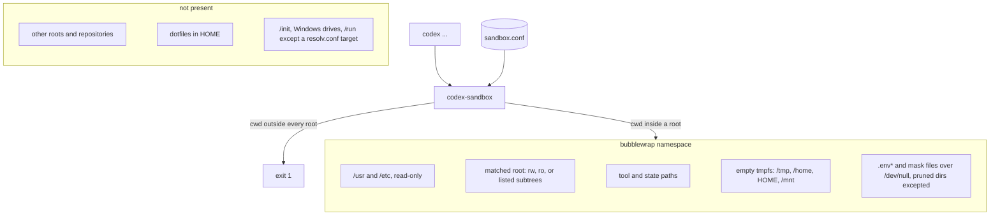
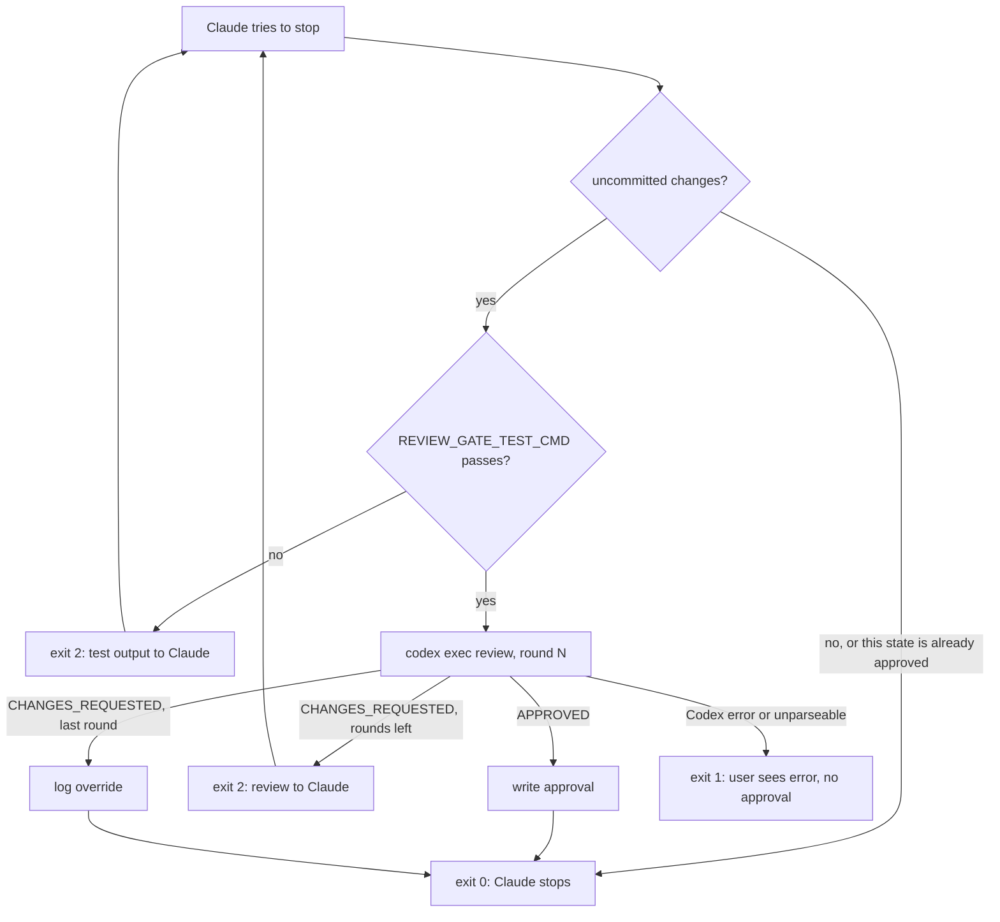
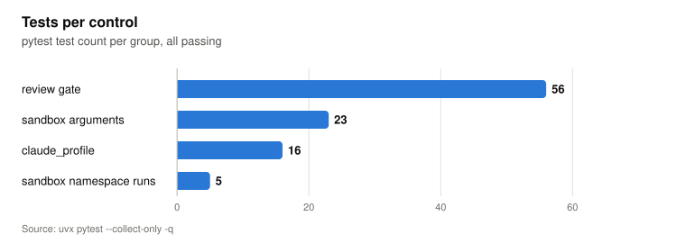

# agent-controls

Three controls for running coding agents on a Linux or WSL2 workstation: a bubblewrap sandbox for the Codex CLI, a Codex review gate for Claude Code's Stop hook, and per-profile Claude Code configuration.

<!-- chart: hero -->
<picture>
  <source media="(prefers-color-scheme: dark)" srcset="docs/figures/hero-dark.svg">
  
</picture>

<details><summary>Data table</summary>

| Measure | Value |
|---|---|
| Control tests | 67 |
| Namespace runs | 5 |
| Review rounds | 2 |
| Prompt cap, bytes | 204,800 |

Source: `uvx pytest --collect-only -q; hooks/codex-review-gate.sh`

</details>

## What it does

- **`bin/codex-sandbox`** runs Codex in a mount namespace that contains only the working root you are in. Other repositories, dotfiles in `$HOME` and, on WSL, the Windows drives do not exist inside it. `.env*` files in the root are overmounted with `/dev/null`, except inside the pruned directories listed under limitations.
- **`hooks/codex-review-gate.sh`** runs the project's tests and a Codex review of the uncommitted changes each time Claude tries to stop. Failing tests or blocking review findings send Claude back to work.
- The gate caps review rounds (`REVIEW_GATE_MAX_ROUNDS`, default 2) and logs every verdict and override to `.ai/reports/qa_decisions.jsonl`.
- **`shell/claude-profiles.sh`** defines `claude_profile <name>`, which gives each account or engagement its own Claude Code config directory and, optionally, its own long-lived OAuth token.
- [docs/threat-model.md](docs/threat-model.md) lists, per control, the threats it addresses, the ones it does not, and the test that checks each claim.

## How it works

### codex-sandbox

Codex's `--sandbox read-only` policy restricts writes and leaves reads open. A probe on 2026-08-30, recorded in the header of `bin/codex-sandbox`, showed Codex in read-only mode reading a file outside its working directory and listing an unrelated repository. The wrapper enforces the read boundary with bubblewrap: a path that is not bound into the namespace does not exist for Codex.



The config file lists working roots (`rw` or `ro`), read-only `tool` paths such as the Node install that Codex runs from, read-write `state` paths such as `~/.codex`, and environment changes. A read-only root can be limited to named subtrees; its `.git` is then absent, and `codex exec` gets `--skip-git-repo-check`. [examples/sandbox.conf](examples/sandbox.conf) documents every keyword.

### codex-review-gate



Round 1 is a full review. Later rounds verify only the fixes for the previous round's blockers. A round counts only when Codex returns a verdict, so a test failure or a Codex outage does not use one. A change to the `git status --short` output starts a new batch at round 1. A new changed file does this, and so does `git add` with no content change, because each status line carries the file's two status letters. The approval records a hash of HEAD, the status, the index entries, the unstaged diff and the untracked file contents, so any later edit or staging change triggers a new review. The state is hashed before the tests run; if it differs after the review, the gate exits 1 without an approval. Codex's prompt is assembled from `templates/codex_reviewer.md`, the diffs, the untracked files and the test output, capped at 204800 bytes (`REVIEW_GATE_MAX_PROMPT_BYTES` default in `hooks/codex-review-gate.sh`).

### claude_profile

`claude_profile work` runs `claude` with `CLAUDE_CONFIG_DIR=~/.claude-work`. If `~/.config/claude-tokens/work` exists and is non-empty, its contents become `CLAUDE_CODE_OAUTH_TOKEN` for that run. `CLAUDE_CODE_OAUTH_TOKEN`, `ANTHROPIC_API_KEY` and `ANTHROPIC_AUTH_TOKEN` inherited from the calling shell are removed for the run, so a profile without a token file does not sign in with another account's token. Settings, permissions, hooks, plugins, memory and transcripts stay per profile. A `GH_CONFIG_DIR=...` prefix on an alias pairs a profile with a GitHub CLI identity.

## Verification

<!-- chart: tests-per-control -->
<picture>
  <source media="(prefers-color-scheme: dark)" srcset="docs/figures/tests-per-control-dark.svg">
  
</picture>

<details><summary>Data table</summary>

| Item | Value |
|---|---|
| review gate | 28 |
| sandbox arguments | 21 |
| claude_profile | 13 |
| sandbox namespace runs | 5 |

Source: `uvx pytest --collect-only -q`

</details>

| Test file | What it checks |
|---|---|
| tests/test_codex_sandbox.py | 21 checks of the bwrap arguments built from a config (binds, masks, subtree roots, refusals, WSL routes, config errors), and 5 runs of a stand-in Codex inside a real namespace: files outside the root are absent, `.env` content is unreadable, `ro` roots refuse writes, `$HOME` and `/mnt` are empty, `/init` is absent |
| tests/test_review_gate.py | 28 runs of the gate against a throwaway git repository with Codex replaced by a stub: approval, blocking, the round cap and override, batch reset, test failures, reviewer failures, locking and lock takeover by age, prompt cap, dispute logging |
| tests/test_claude_profiles.py | 13 checks of config dir and token selection, and refusal of unsafe profile names |
| tests/test_links.py | Every relative link and image in the Markdown and HTML files resolves |

The namespace tests are skipped where the wrapper cannot create its namespace; the probe runs `bin/codex-sandbox` itself, with its real bwrap flags. `pytest -rs` prints each skip reason. `CODEX_SANDBOX_REQUIRE_NAMESPACE=1` turns the skips into failures. CI installs bubblewrap, enables unprivileged user namespaces and runs with `-rs` ([.github/workflows/ci.yml](.github/workflows/ci.yml)).

## Quickstart

Requirements: bash 4.4 or later, git, Python 3.10 or later, [uv](https://docs.astral.sh/uv/), `flock` from util-linux for the review gate, and bubblewrap (`apt install bubblewrap`) for the sandbox.

The steps below keep the checkout path in `AGENT_CONTROLS`, so they work after a `cd` into a project.

```bash
AGENT_CONTROLS=~/agent-controls
git clone https://github.com/darblinko/agent-controls "$AGENT_CONTROLS"
cd "$AGENT_CONTROLS"
uvx pytest -q
uvx --from shellcheck-py shellcheck bin/codex-sandbox hooks/codex-review-gate.sh shell/claude-profiles.sh
```

### Install the sandbox

```bash
mkdir -p ~/.local/bin ~/.config/agent-controls
cp "$AGENT_CONTROLS/examples/sandbox.conf" ~/.config/agent-controls/     # edit the roots and tool paths
ln -s "$AGENT_CONTROLS/bin/codex-sandbox" ~/.local/bin/codex             # must come before the real codex on PATH
cd ~/src/my-app                                                          # a configured root
CODEX_SANDBOX_DRY_RUN=1 codex exec "list the files"                      # print the bwrap command
codex exec "list the files"
```

The wrapper finds the real Codex as the next `codex` on `PATH`; set `CODEX_BIN` to override. `CODEX_UNCONFINED=1` bypasses the namespace.

### Install the review gate in a project

```bash
cd ~/src/my-app
mkdir -p hooks .ai
cp "$AGENT_CONTROLS/hooks/codex-review-gate.sh" "$AGENT_CONTROLS/hooks/review_gate.py" hooks/
cp "$AGENT_CONTROLS/templates/codex_reviewer.md" "$AGENT_CONTROLS/templates/codex_review_schema.json" .ai/
echo '.ai/reports/' >> .gitignore
```

Merge [examples/claude-settings.json](examples/claude-settings.json) into `.claude/settings.json` and set the test command in it. Copy [examples/review-gate-command.md](examples/review-gate-command.md) to `.claude/commands/review-gate.md` for a `/review-gate on|off|status` command. Edit `.ai/codex_reviewer.md` to add project-specific blocking criteria.

### Use profiles

```bash
echo ". $AGENT_CONTROLS/shell/claude-profiles.sh" >> ~/.bashrc
alias work='cd ~/src/work && GH_CONFIG_DIR=$HOME/.config/gh-work claude_profile work'
```

For a separate account, store a long-lived token from `claude setup-token`:

```bash
install -d -m 700 ~/.config/claude-tokens
(umask 077 && cat > ~/.config/claude-tokens/work)   # paste the token, then Ctrl-D
```

## Project layout

```text
bin/codex-sandbox              bubblewrap wrapper for the Codex CLI
hooks/codex-review-gate.sh     Claude Code Stop hook
hooks/review_gate.py           verdict parsing and decision log entries for the hook
shell/claude-profiles.sh       claude_profile function
templates/                     reviewer prompt and review JSON schema for .ai/
examples/                      sandbox.conf, Stop hook settings, /review-gate command
docs/threat-model.md           threats, mechanisms, gaps, tests
docs/data.json, docs/figures/  figure data and the SVGs generated from it
tools/svgchart.py              SVG generator for docs/figures, standard library only
docs/index.html                landing page for GitHub Pages, charts from docs/data.json
tests/                         pytest suite that drives the scripts
```

## Design decisions and limitations

- The read-only Codex policy is not treated as a read boundary, because of the 2026-08-30 probe above. The Codex version used in that probe was not recorded.
- The network is shared with Codex. Anything inside the bound root can leave the machine. The sandbox limits what Codex can read; it does not limit where Codex can send it.
- `.env*` and `mask` patterns are matched by file name when Codex starts. Secrets under other names, files created later and symbolic links are not masked. The search prunes directories named `node_modules`, `.git`, `.venv`, `venv` and `__pycache__`, so a `.env` file inside one of them stays readable.
- `/run` is absent except when `/etc/resolv.conf` resolves into it; that one file is then bound read-only. `/init` is absent. The tests check that `/run` and `/init` are not bound and that `WSL_INTEROP` and `WSLENV` are unset. Whether an absent `/init` disables the WSLInterop binfmt_misc handler depends on its registration flags and is untested.
- The calling shell's environment passes into the namespace, except `WSL_INTEROP`, `WSLENV` and `unsetenv` entries.
- After the last review round, Claude may stop with blockers still open. They are logged, and a person has to read the log.
- The gate reviews uncommitted changes only. Work committed before Claude stops is not reviewed.
- A test command that writes files the gate sees (tracked, or untracked and not ignored) changes the state between the hash and the review, so the gate never approves. Ignore such output in `.gitignore`.
- A stop that finds the review lock held by a live process younger than `REVIEW_GATE_LOCK_STALE_SECONDS` (default 1500) exits 0 without tests or a review, and Claude stops. The skip is logged only in `.ai/reports/qa_activity.log`. The default is above the 1200-second Stop hook timeout in [examples/claude-settings.json](examples/claude-settings.json); a longer hook timeout needs a larger value.
- Untested: deletion of the previous review when the batch changes, untracked files over 51,200 bytes (cut to their first 200 lines), the batch reset caused by staging, and the real Codex CLI. The gate tests replace Codex with a stub.
- A reviewer failure exits 1, which Claude Code reports to the user without blocking. A gate that blocked on its own failures could hold Claude in a loop it cannot resolve.
- The gate is disabled with a marker file, `.ai/reports/disabled`, because an environment variable exported from a Claude Code Bash tool call does not reach the hook process.
- Profile tokens travel as an environment variable and are readable by the same user's processes. See [docs/threat-model.md](docs/threat-model.md).

## Figures

The README charts and the landing page charts are generated from one file, [docs/data.json](docs/data.json). Every number in it is copied or computed from a file or command in this repository, and each chart's `source` field names it. To regenerate the SVGs after a data change:

```bash
python3 tools/svgchart.py docs/data.json docs/figures
```

[tools/svgchart.py](tools/svgchart.py) uses the Python standard library only. It writes `docs/figures/<name>-light.svg` and `<name>-dark.svg` for every chart and prints a Markdown snippet per chart: a `<picture>` element, which lets GitHub pick the variant for the viewer's theme, and a collapsed data table. The snippets are pasted into this README under the matching `<!-- chart: <name> -->` comment. [docs/charts.js](docs/charts.js) renders the same data on the landing page.

### docs/data.json schema

```json
{
  "meta": {"repo": "agent-controls", "revision": "<commit>", "measured": "<YYYY-MM-DD>"},
  "charts": [
    {"name": "tests-per-control", "type": "hbar", "title": "Tests per control",
     "subtitle": "pytest test count per group", "source": "uvx pytest --collect-only -q",
     "alt": "Text alternative for the chart.", "format": "number",
     "data": [{"label": "review gate", "value": 28}]}
  ]
}
```

Every chart has `name` (used in the SVG file names and in `data-chart` on the landing page), `type`, `title`, `subtitle`, `source` and `alt`. The fields per type:

| type | Required fields | Use |
|---|---|---|
| hbar | data: [{label, value, status?, note?}]; optional max, threshold {value, label} | Per-item comparisons. status is "pass" or "fail" and prints as text beside the bar. |
| columns | categories: [...], series: [{name, values}] (1 to 4 series) | Counts per category |
| line | x: [...], series: [{name, values}] (1 to 4 series; null for a gap; the last value must be a number); optional min, max | Change over runs or time |
| stats | tiles: [{label, value (preformatted string), note?}] | Headline figures, at most 4 tiles per row |

`format` is one of `percent` (values are fractions, 0.86 prints as 86%), `number` (the default, 2,909), `decimal2` or `decimal3`. Each chart has one y-axis and at most 4 series.

## License

Apache-2.0. See [LICENSE](LICENSE). Copyright 2026 Mitchell Foutz.
